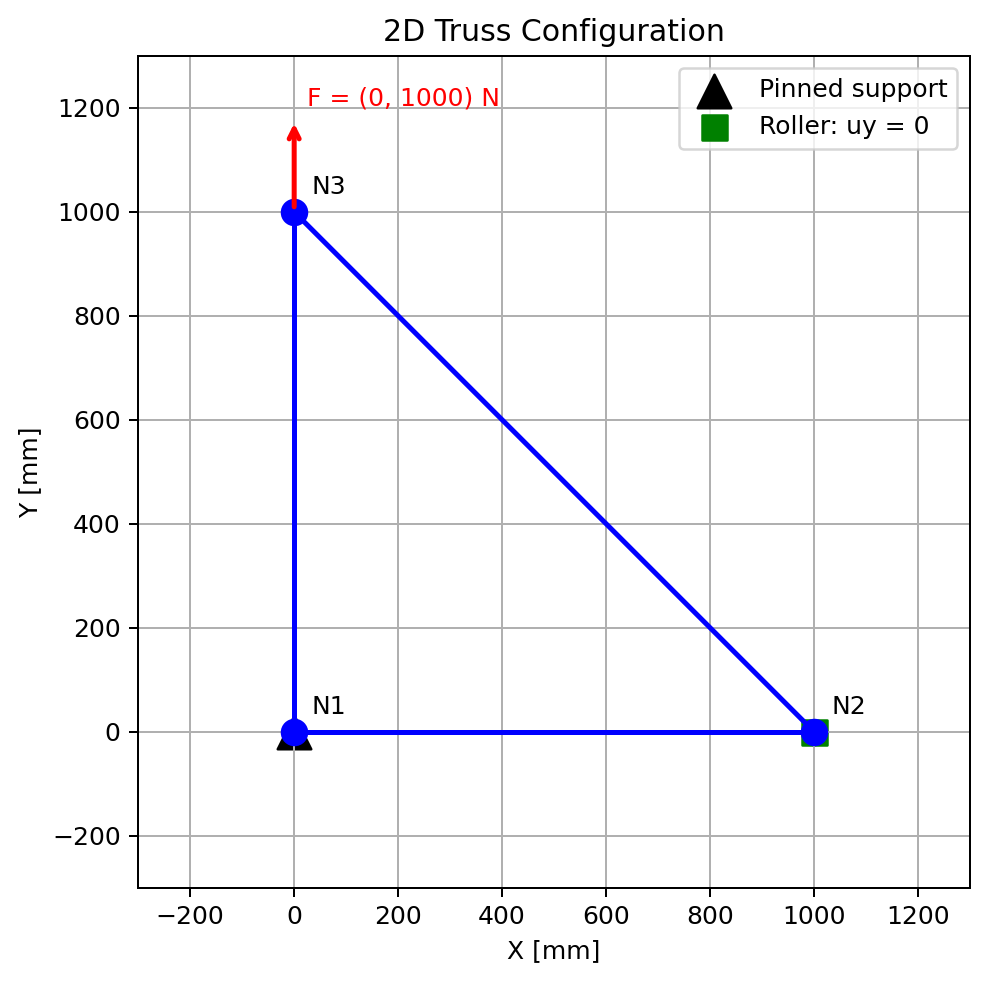

# 2D Truss Solver

A mechanical engineering portfolio project implementing the direct stiffness method in Python. Calculates nodal displacements, support reactions and axial stresses for planar pin-jointed trusses.



## Quick start

Requires Python 3.10 or newer. From the repository root:

```bash
python -m pip install -r requirements.txt
python src/main.py
```

On Windows, `py` can replace `python`. The program runs locally in a terminal and displays a Matplotlib window; GitHub hosts the source and documentation.

## Input workflow

1. Enter distinct integer node coordinates in mm as `(x,y)`; enter `stop` when finished.
2. Enter the coordinates of the pinned support, then the roller support.
3. Enter node pairs such as `(1,2)` to define each element. Node numbering follows input order.
4. Enter `(Fx,Fy)` in N for **every node**, including `(0,0)` for unloaded nodes.

**`(1000,0)` means a horizontal force. `(0,1000)` means a vertical force.** Signed integer forces and spaces are supported. Coordinates range from 0 to 100000 mm; force components from -99999999 to +99999999 N.

The applied-load table is printed before solving so the model can be checked. Results include full displacement and reaction vectors and formatted node, support and element tables. Close the plot window to finish.

## Scope and assumptions

- Linear elastic, small-displacement, two-dimensional analysis.
- Pin-jointed axial elements; no bending or rotational degrees of freedom.
- One pinned support (`ux = uy = 0`) and one roller (`uy = 0`).
- Uniform area of 1200 mm² and Young's modulus of 200 GPa, editable at the top of the source.
- Nodal loads only; no automatic self-weight, buckling or design-code checks.
- The interactive workflow requests `2n - 3` bars. This count does not guarantee stability.
- Numerically rank-deficient systems are rejected; this check is not a complete assessment of conditioning.

Displacements are in mm, reactions in N and stresses in MPa. Positive stress indicates tension; negative stress indicates compression.

## Verification

Run the eight regression tests:

```bash
python -m unittest discover -s tests -v
```

They cover the analytical triangle under both vertical load directions, horizontal loading, reordered nodes, a four-node model, loads applied at supports, invalid connectivity, unstable geometry and insufficient nodes. Table indexing is checked against the computed vectors.

See [the benchmark](examples/triangular_truss.md), [methodology](docs/methodology.md) and [release notes](CHANGELOG.md). Actual console outputs are included in `results/`.

## Repository layout

- `src/main.py`: interactive solver and plotting, retaining the original function-based structure.
- `tests/test_solver.py`: numerical and reporting regression checks.
- `examples/triangular_truss.md`: reproducible input and expected results.
- `docs/methodology.md`: formulation and indexing convention.
- `results/`: benchmark figure, console outputs and test log.

## Future work

Structured model imports, per-element properties, general support configurations and deformed-shape plotting.
