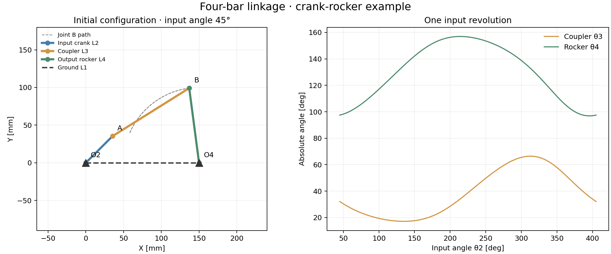

# Four-Bar Mechanism Kinematic Analysis

This project develops a Python-based tool for the kinematic analysis of a planar four-bar linkage.

The mechanism is modelled through nonlinear loop-closure constraint equations. Joint positions are obtained numerically, while velocities and accelerations are calculated using the Jacobian of the constraint system.

Symbolic expressions are generated with SymPy and converted into numerical functions for efficient evaluation with NumPy and SciPy.

The project also includes geometric validation and dynamic visualization of the mechanism motion.



## Main features

- Four-bar linkage geometric model.

- Loop-closure constraint equations.

- Numerical position analysis.

- Jacobian-based velocity analysis.

- Jacobian-based acceleration analysis.

- Grashof and geometric feasibility checks.

- Joint trajectory calculation.

- Angular velocity and acceleration results.

- Animated mechanism visualization.

- Modular Python architecture prepared for extension to more complex mechanisms.

## Technologies

Python · NumPy · SciPy · SymPy · Matplotlib


## Run the program

From the repository root, with Python 3.10 or newer:

```bash
python -m pip install -r requirements.txt
python -m src.main
```

Use the module command above because the source imports modules from the `src` package. On Windows, `py` can replace `python`.

## Reproduce the example

```bash
python -m examples.run_example
```

The example uses link lengths of 150, 50, 120 and 100 mm, an initial input angle of 45°, and a constant input speed of 2 rad/s. It saves figures and numerical results to `results/`.

[Inputs and results](examples/crank_rocker.md) · [Animated example](results/mechanism_motion.gif) · [Model notes](docs/notes.md)

To export the GIF again, run `python -m examples.run_example --gif`.

## Interpreting the animation

The interactive display sweeps through input angles at a fixed playback rate; it is not a time simulation of the supplied actuator velocity and acceleration. The separate example plots and GIF use a consistent constant-speed time law.

The initial guess selects an assembly branch. Grashof and link-length checks do not guarantee that every requested configuration is reachable. Singular states are reported, and the model assumes rigid planar links and ideal joints.

## Checks

```bash
python -m unittest discover -s tests -v
```

The checks cover loop closure, link lengths, numerical differentiation of position, unreachable configurations and singularity handling. See [packaging notes](docs/changes.md) for the small changes made to the original code.
