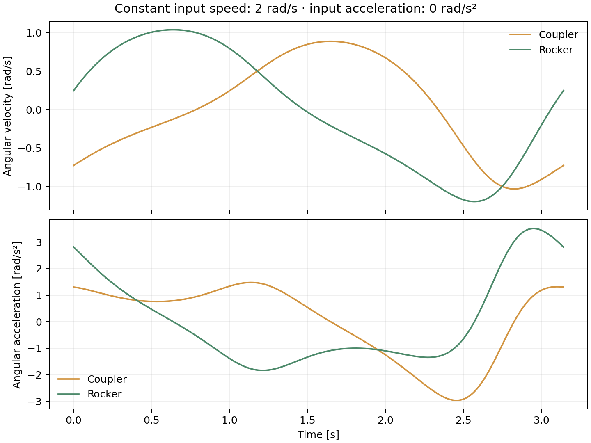

# Example: crank-rocker linkage

This example uses a short input crank that can rotate through a complete revolution while the output rocker oscillates.

| Input | Value |
|---|---:|
| Ground L1 | 150 mm |
| Input crank L2 | 50 mm |
| Coupler L3 | 120 mm |
| Output rocker L4 | 100 mm |
| Initial input angle | 45° |
| Input angular velocity | 2 rad/s |
| Input angular acceleration | 0 rad/s² |

For these lengths, the Grashof inequality is strict: 50 + 150 < 100 + 120. The input is the shortest link and is adjacent to the ground link. This selected geometry admits a full input revolution without a toggle singularity.

## Run the example

From the repository root:

```bash
python -m examples.run_example
```

The script saves a configuration figure, kinematic curves, a CSV with 361 samples and a short text summary in `results/`. Existing files with the same names are replaced. To keep another copy, add `--output results/my_run`.

To regenerate the GIF as well:

```bash
python -m examples.run_example --gif
```

The GIF uses Matplotlib's Pillow writer (Pillow is installed with Matplotlib). It contains 80 frames over one cycle; playback timing is approximate because GIF frame delays are quantized.

## Run it interactively

```bash
python -m src.main
```

Enter the following values in order, then press Enter when asked to start the animation:

```text
150
50
45
120
100
2
0
```

Note that the initial angle is requested before L3 and L4.

## Initial results

The numerical solver starts from guesses of 45° for the coupler and 90° for the rocker. These guesses select the assembly branch illustrated below.

| Quantity | Input crank | Coupler | Rocker |
|---|---:|---:|---:|
| Absolute angle [deg] | 45.000000 | 32.115384 | 97.473727 |
| Angular velocity [rad/s] | 2.000000 | -0.727111 | 0.245330 |
| Angular acceleration [rad/s²] | 0.000000 | 1.304261 | 2.815362 |

Positive angular motion is counterclockwise. All link angles are measured from the global positive X axis, despite the original variable names `theta12`, `theta23` and `theta14`.


## One revolution

The example uses constant input speed:

```text
theta2(t) = theta2_initial + 2*t
T = 2*pi/2 = pi seconds
```

The calculated cycle lasts 3.141592654 s. The largest absolute loop-closure residual in the generated data is about 7.23e-10 mm. This is a numerical consistency check, not a manufacturing accuracy claim.



Even with zero input acceleration, the other links have nonzero angular acceleration because their velocity ratios vary with configuration.

The traced point B is the joint between coupler and rocker. Its path is an arc centred on O4 with radius L4; it is not a general point somewhere along the coupler.

## Additional cases to try

### Reverse the input velocity

Use the same geometry and angle, but enter -2 rad/s and 0 rad/s². At the same initial configuration the coupler and rocker velocities reverse sign, while their accelerations remain unchanged. The interactive animation still sweeps angles in the positive direction: it is a configuration sweep, not a time simulation. The included GIF is specifically for the +2 rad/s case.

### Geometrically impossible linkage

Try L1 = 400 mm, L2 = 50 mm, input angle = 45°, L3 = 100 mm and L4 = 100 mm. The longest link exceeds the sum of the other three, so the program should reject the geometry before asking for actuator motion.

### Closure depends on the requested angle

With L1 = 150 mm, L2 = 100 mm, L3 = 80 mm and L4 = 60 mm, some configurations can close. At an input angle of 180°, however, A and O4 are 250 mm apart, greater than L3 + L4 = 140 mm. The requested initial position should be rejected.
