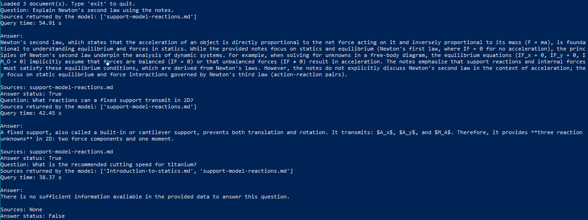

# Engineering Notes Assistant

A small command-line assistant that answers questions using engineering notes and a local Ollama model. This is a learning project about Python, structured model responses, file handling and conversation history.

## Features

- Loads non-empty `.md` and `.txt` files from `data/`, including subfolders.
- Sends the documents and conversation history to `qwen3:8b`.
- Requests JSON output and validates its structure with JSON Schema.
- Rejects references to files that were not supplied.
- Saves accepted exchanges to `outputs/Chat_exchange.json`.

It does not browse the internet or provide tools to the model. The documents are supplied as context; this version does not use embeddings, a vector database or document retrieval.

## Setup

Use Python 3.10 or later and install [Ollama](https://ollama.com/). Run Ollama locally, then download the model:

```bash
ollama pull qwen3:8b
```

From this project folder:

```bash
python -m venv .venv
```

Activate the environment on Windows PowerShell:

```powershell
.\.venv\Scripts\Activate.ps1
```

Or on Linux/macOS:

```bash
source .venv/bin/activate
```

Install and run:

```bash
python -m pip install -r requirements.txt
python main.py
```

If Ollama is not already running, start it with `ollama serve` in another terminal. This project assumes a local Ollama server and a locally downloaded model. Downloading the software and model requires an internet connection.

## Usage

Put your notes in `data/` before starting the program. PDF files are not supported. Three sample statics notes are included; check their content and add source attribution for any material adapted from external publications.

Try:

- `What reactions can a fixed support transmit in 2D?`
- `Explain Newton's second law using the notes.`
- `What is the recommended cutting speed for titanium?` (not covered by the supplied notes)

Type `exit` to stop. Blank questions are ignored. The program accumulates response chunks and displays the complete answer after validation.

The saved file contains a list of exchanges with these fields:

| Field | Meaning |
|---|---|
| `asked_question` | Original user question |
| `given_answer` | Answer in English, or a standard insufficient-information message |
| `source_used` | Relative paths of cited documents |
| `answer_status` | Boolean: whether the model reports sufficient information |

**`answer_status` is not a correctness score.** `true` means the model claims it can answer and the software accepted its structure and references. It does not establish that the explanation is factually correct or supported by those sources.

See [examples/example-output.json](examples/example-output.json) for an illustrative output format, manually prepared rather than recorded from an actual model run.



History is held in memory during one session; saved history is not loaded at startup. Each successful save overwrites the output file with the current session, so copy it elsewhere if you want to keep an older session.

## Educational scope and limitations

This is a personal learning prototype, not a validated engineering reference or production application. It can be useful for exploring notes, but its answers should not be used as the sole basis for design calculations, equipment operation or safety decisions.

JSON validation checks the response format. Checking filenames prevents unknown references, but neither check proves that a cited document supports the answer. The model may still use learned knowledge, misinterpret a passage or cite the wrong document. Prompts are not a security boundary.

All documents and previous exchanges are sent as context. Large collections and long sessions can exceed the model's context capacity; this version has no token budget or history trimming. Poor or conflicting notes can lead to poor answers. Keep the initial collection small and check answers against the original material.

## Project files

- `main.py`: document loading, model call, validation and saving.
- `data/`: sample engineering notes.
- `examples/`: illustrative JSON and a short manual test checklist.
- `requirements.txt`: Python dependencies; Ollama and its model are installed separately.
- `CHANGES.md`: small corrections made during the publication review.

## Known issue: source attribution

When several reference documents are loaded, the assistant may cite the last document in the loading order even when another document containsthe relevant information. Changing the filename order has changed both the cited source and the generated answer in local tests.

The model may also return duplicate source names. These are removed before validation, but this does not correct an incorrectly chosen source.

The root cause is still under investigation. Possible areas to check include context handling, document presentation and model behaviour.

The assistant can also answer questions that are not covered by the provided notes. JSON validation and filename checks do not establish that an answer is supported by its cited documents.

This project is an educational prototype. Answers and citations require manual checking, and `answer_status: true` is not a factual verification.

## Next steps

A small evaluation set with expected answers would be the most useful next improvement. Other ideas are quoting supporting passages, saving separate session files, and selecting relevant documents for each question. These are future improvements, not current features.

Structured output follows the [official Ollama example](https://github.com/ollama/ollama-python/blob/main/examples/structured-outputs.py), passing the schema with `format=SCHEMA`.


