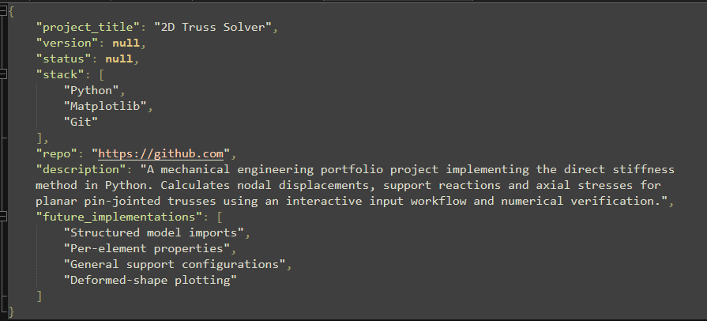

# Engineering Portfolio Presenter

A small Python project that reads engineering project READMEs and creates a short presentation for each one using a local Ollama model.

I built this to practise reading files, working with JSON, using a local language model and handling errors in Python.

## What it does

- Reads `.md` files from the `README/` folder, including subfolders.
- Extracts the project title, version, status, tools, repository link, description and planned improvements.
- Checks the response structure with JSON Schema.
- Saves one JSON file per README in `outputs/`.
- Skips empty files and continues if a file cannot be processed.

## Setup

You need Python, [Ollama](https://ollama.com/) and the `qwen3:8b` model. The Ollama application must be running when you use the script.

From the project folder, install the Python dependencies:

```bash
python -m pip install -r requirements.txt
```

Download the model once:

```bash
ollama pull qwen3:8b
```

## Usage

Put your engineering READMEs inside `README/`. Give each file a different name, or put each project's README in a separate subfolder:

```text
portfolio-presenter/
    main.py
    requirements.txt
    README.md
    README/
        2d_truss_solver.md
        Coating_Process_Optimizer.md
        4bar_linkage.md
	images/
		2d_truss_solver_output
```

The supplied README files are extracted from my current portfolio proyects. The filenames above are examples.
Run:

```bash
python main.py
```

For example, `README/truss_solver.md` produces `outputs/truss_solver.md.json`. The script creates the output folder automatically. Running it again replaces the corresponding successful results. If an input fails, any previous result for it is left unchanged.

Git does not track empty folders. Add your input files before uploading, or create the `README/` folder locally after cloning.

## Results

Open a generated JSON file to review the presentation. Missing scalar information is represented as `null`; undocumented lists are represented as `[]`.





## Limitations

This is a learning prototype. Schema validation checks the format and field types, but cannot verify the accuracy of the generated text. Results should be compared with the original README, particularly current features and future plans.

Each README is sent in a single request. Very long documents may exceed the model's context capacity. Processing time depends on the computer and whether the model is already loaded.

The script reads local files; it does not fetch repositories from GitHub or train a model.
