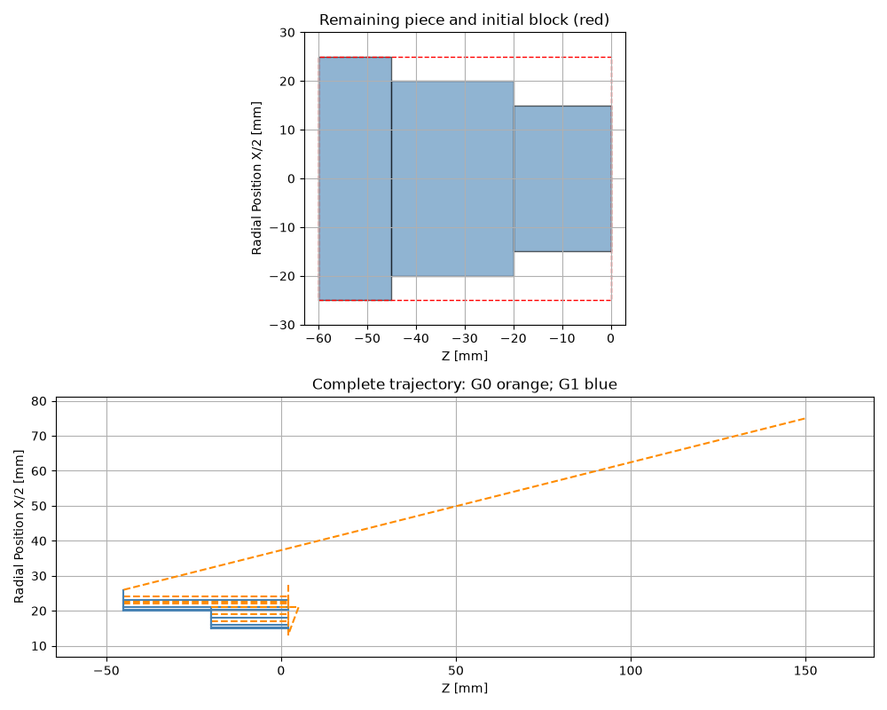

# CNC Lathe Toolpath Viewer

A small Python learning project for reading a simple turning program and plotting its toolpath and approximate final workpiece.

I built this project to practise dataclasses, modal machine state and basic geometry while exploring CNC turning. The implementation is deliberately limited so it is easier to understand and extend.

## What it does

- Reads `G-code/code.nc` and stores each block in a dataclass.
- Tracks the tool position and active G0/G1 mode between blocks.
- Divides the stock into axial intervals and updates their diameters after longitudinal cuts.
- Plots the remaining stock and the complete toolpath on separate axes.
- Checks positive stock dimensions and cutting moves beyond the back of the stock.



## Run

Use Python 3.10 or later. From this project folder:

```bash
python -m pip install -r requirements.txt
python main.py
```

For the supplied example, enter **50 mm diameter** and **60 mm length**.

| Z interval (mm) | Final diameter (mm) |
|---|---:|
| -60 to -45 | 50 |
| -45 to -20 | 40 |
| -20 to 0 | 30 |

The first interval remains at the original stock diameter. Moving the tool out to X52 does not add material or create a finished diameter of 52 mm.

## Assumptions and supported input

Coordinates are interpreted as **absolute millimetres**, with **X as diameter**. The stock extends from Z=-length to Z=0. The plot uses X/2 to show the physical radius.

Words must be separated by spaces, for example `G01 Z-20.0 F0.12`. O program numbers and N block numbers are accepted. Comments use parentheses or a semicolon. One G word per block is supported.

G0 and G1 are modal. The first positioning move must be G0 and establish both X and Z. G1 requires an active positive F value. G50 S, G96/G97, S, T and M3/M4/M5/M8/M9 are recognised but their physical effects are not simulated. M30 ends the program. Other G/M codes are rejected, including explicit unit or coordinate-mode declarations: the assumptions above are fixed in this version.

Only axial G1 cuts at constant X remove material. Outward radial moves are allowed. Inward radial cuts into the workpiece and diagonal G1 moves are rejected. This is not a general G-code interpreter.

## Educational scope

This is an educational visualisation, **not a program verifier for a real CNC machine**. It does not model tool nose radius, tool offsets, holders, chuck geometry, machine limits or complete collisions. Rapid-move warnings are approximate. It does not simulate facing, grooves, tapers, arcs, drilling, threading or canned cycles.

A longitudinal G1 move beyond Z=-length is rejected conservatively, even if it could be an air move. Rapid approaches and retracts outside the stock are allowed; separate plot scales keep these moves from shrinking the workpiece view.

Do not use the output to approve machining or establish that a program is safe to run. No cutting times or spindle behaviour are calculated.

## Understanding the code

Start with `CNCCommand`, `MachineState` and `Cylinder`. Then follow `parse_commands`, `create_cylinder`, `simulate` and `draw_result`. 

Possible next steps: calculate removed volume, select the input file, and add a step-by-step display of diameter changes. More operations can be added gradually with dedicated examples.
