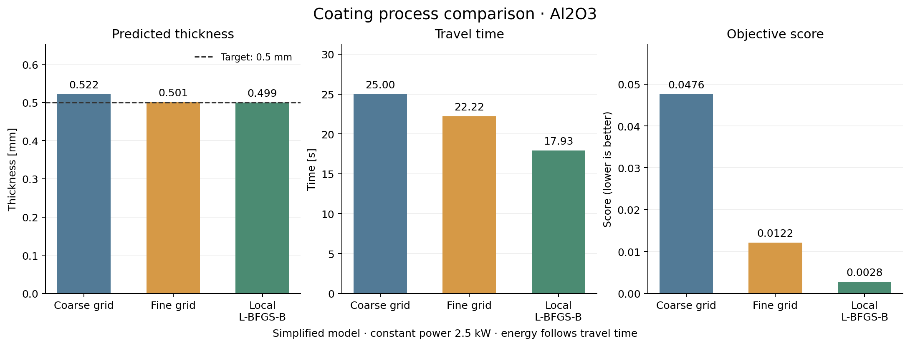

# Example: Al2O3, 0.5 mm target

Run:

```bash
python src/main.py --example --no-show
```

The equivalent interactive inputs are:

```text
0.5
1000
10
1
```

They mean target thickness 0.5 mm, coating length 1000 mm, effective width 10 mm and material Al2O3.

## Calculated results

| Method | Mass flow [g/s] | Speed [mm/s] | Passes | Thickness [mm] | Error [mm] | Time [s] | Energy [kWh] |
|---|---:|---:|---:|---:|---:|---:|---:|
| Coarse grid | 1.500000 | 40.000000 | 1 | 0.522152 | 0.022152 | 25.000000 | 0.017361 |
| Fine grid | 1.618182 | 45.000000 | 1 | 0.500703 | 0.000703 | 22.222222 | 0.015432 |
| Local L-BFGS-B | 2.000000 | 55.769025 | 1 | 0.499347 | 0.000653 | 17.931101 | 0.012452 |

Values are rounded. The CSV contains the full calculated values; last digits can vary with SciPy versions. Timing values are deliberately not used as reference answers.

## Manual unit check

For 1 g/s, 50 mm/s, two passes, 10 mm width and Al2O3:

```text
rho = 3.95 / 1000 = 0.00395 g/mm³
h = 1 * 0.55 * 2 / (0.00395 * 50 * 10) = 0.5569620253 mm
t = 1000 / 50 * 2 = 40 s
E = 2.5 * 40 / 3600 = 0.0277777778 kWh
```

The deposited mass is 1 * 40 * 0.55 = 22 g. The same mass is obtained from thickness * length * width * density.

## Reading the figure

The dashed line marks the target thickness. The other panels show travel time and score. Energy is kept in the table because, at constant power, a separate energy chart would repeat the time comparison.

The fine grid is restricted to the coarse winner's neighbourhood: its speed limit is 45 mm/s in this run. Local search can explore the complete 30–60 mm/s range. This difference helps explain the results.


